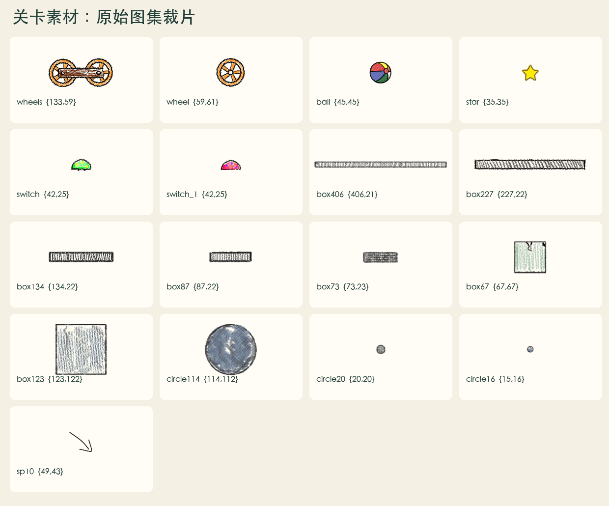
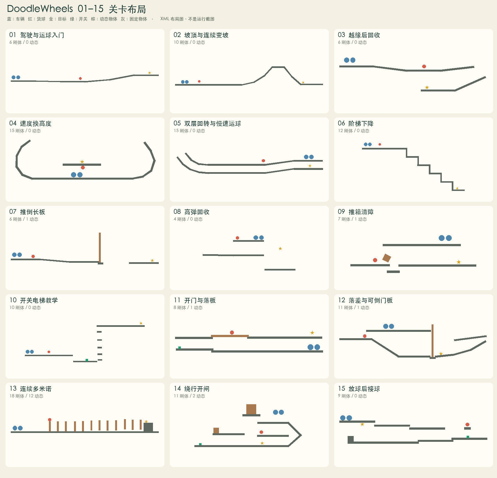
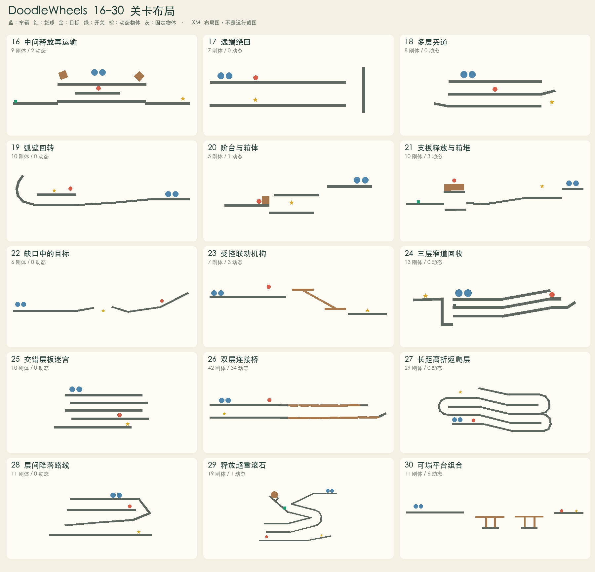
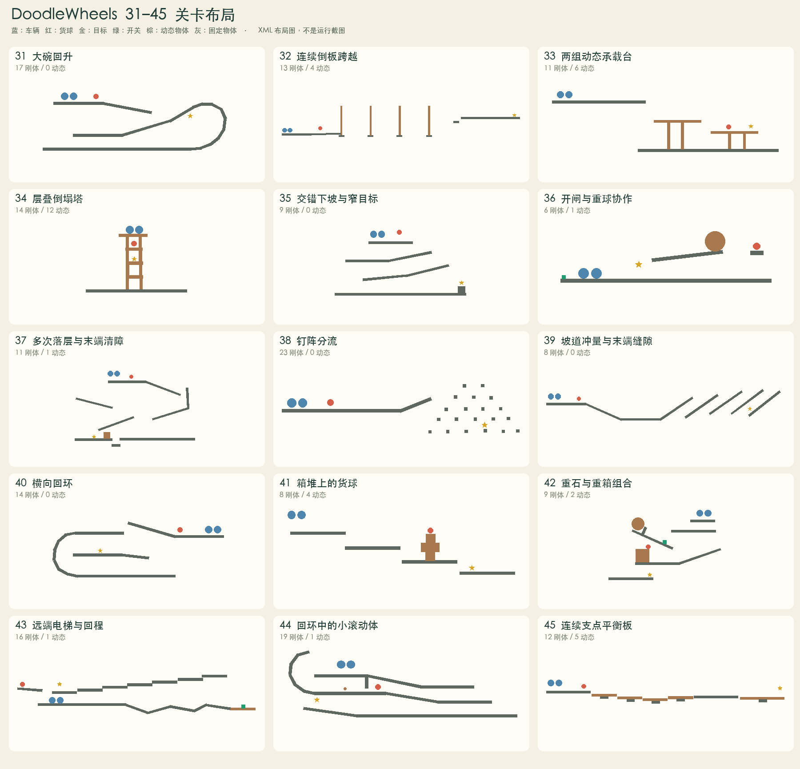

# 原版 1～45 关：素材与关卡设计复盘

分析对象：当前工程的 `decompiled/apktool/assets/lvs/v1.dwl`～`v45.dwl`。已逐字节确认它们与 `decompiled/raw/` 原始 45 关一致，未混入后增 46～60 关。素材尺寸取自 `assets/res/entity.plist`，教学文字取自 `assets/res/strings.xml`，机关类型结合 Lua 与原生函数核对。

**证据层级：**数量、坐标、物理属性、脚本调用和教学文字是文件事实；下文关卡名称是为复盘而拟定，玩法思想与预期解题过程是依据布局的分析，不是恢复出的原始设计文档，也不代表已逐关真机通关。

## 整体判断

这 45 关的主轴是“用可左右驾驶的小车间接控制球，让球触达星星”。设计资源主要来自重力、动量、车球相对位置以及路面状态改变。关卡既有直接运球，也有绕行、回收、接应、触发机关后返回等问题。

素材库保持精简：同一长板能是固定路面、弯道的一段、竖直障碍、可倒桥板、可坍塌平台、升降台或联动杆。新的玩法往往由同一素材的新参数、新排列或新约束产生。

## 素材清单与使用量

45 关共包含 **535 个 body 声明：430 个静态、105 个动态**（按 XML density 是否大于 0 分类，Lua 可能在运行中改变类型）。每关各有 1 辆车、1 个货球、1 个目标；另外有 10 个开关、13 条文字、3 个 sp10 指xia示图。22 关有非空 Lua 脚本。

| 素材名 | 原图逻辑尺寸（像素） | body 数量 | 常见用途 | 出现关卡 |
|---|---:|---:|---|---|
| `box406` | 406×21 | 265 | 路面骨架、坡面、墙、倒板、承载台 | 1, 2, 3, 4, 5, 6, 7, 8, 9, 10, 11, 12, 13, 14, 15, 16, 17, 18, 19, 20, 21, 22, 23, 24, 25, 26, 27, 28, 29, 30, 31, 32, 33, 34, 35, 36, 37, 38, 39, 40, 41, 42, 43, 44, 45 |
| `box227` | 227×22 | 58 | 中段接续、台阶、支板、动态平台 | 2, 4, 6, 12, 14, 21, 22, 23, 24, 28, 30, 31, 33, 34, 37, 38, 40, 42, 43, 45 |
| `box134` | 134×22 | 50 | 细化弯道、竖挡、短横梁、多米诺 | 4, 5, 6, 9, 13, 18, 19, 24, 30, 33, 34, 43, 44 |
| `box87` | 87×22 | 78 | 小步长弯道、桥板、塔柱 | 19, 24, 26, 27, 29, 31, 34, 37, 40, 44 |
| `box73` | 73×23 | 22 | 支点、闸挡、小台面 | 7, 10, 12, 15, 24, 29, 32, 36, 42, 45 |
| `box67` | 67×67 | 15 | 可推箱、配重、堆叠、固定支座 | 9, 14, 15, 16, 20, 21, 35, 37, 41 |
| `box123` | 123×122 | 3 | 大箱、重障碍、末端挡体 | 13, 14, 42 |
| `circle114` | 114×112 | 3 | 重力滚石 | 29, 36, 42 |
| `circle20` | 20×20 | 40 | 连接体、离散障碍、小滚动物 | 24, 26, 38, 44 |
| `circle16` | 15×16 | 1 | 联动支点 | 23 |

车辆、球、星星和按钮由专用标签实例化，不计入上表 body 数量。`wheel`、`wheels`、`ball`、`star`、`switch`、`switch_1` 是相应图集帧；`sp10` 仅出现在 1、9、15 关，属于指示性视觉。

### 物理与视觉应分开理解

- `density=0` 是静态构件，大于 0 是初始动态构件；密度不是质量本身，还要结合面积。第 29 关圆石密度 50、第 42 关圆石密度 35，和普通轻板差异很大。
- 535 个 body 中 525 个摩擦系数为 0.9，475 个弹性系数为 0.3；大部分构件规则稳定，少数例外承担特殊玩法。
- `restitution=1.5` 的两个 body 位于第 8、24 关；第 8 关教学直接说明红色高弹，第 24 关红色 go30 也设为高弹。颜色用于提示，但物理表现由属性和接触决定。
- `circle20` 出现 40 次，但图像名不等于圆形碰撞体。第 26、38 关这些小图元均声明 `isCircle=false`；整个原版只有 4 个 body 声明真圆形：29、36、42 关的大圆石及 44 关的小圆体。
- 唯一 `isSensor=true` 的 body 在第 23 关，用作不产生普通实体碰撞的联动杆。

### 共用表现资源

`res/bg0.jpg`、`bg1.jpg`、`bg2.jpg`、`bg3.png` 提供背景，`entity.png`/`entity.plist` 提供物体图集，`font.png`/`font.fnt` 和 `strings.xml` 提供数字与文字。`levels`、`start` 图集主要属于菜单；`ptc.plist`、`star_0.png` 属于粒子/星星表现。

`bgm.mp3`、`switchon.mp3`、`win.mp3`、`transition.mp3`、`football.mp3` 是包内共享音频。关卡 XML 没有逐关选择背景或音效的字段，因此这里不把它们硬分配到某一关。

## 逐关复盘

表中的素材是具体结构概括，完整 frame 数量和原始脚本见 [机器可读清单](levels-01-45-inventory.json)。

### 第 1～15 关

| 关卡 / 复盘名称 | 素材与结构 | 玩法思想（归纳） | 直接证据 / 边界 |
|---|---|---|---|
| 01 驾驶与运球入门 | 长板铺路、缓坡、文字提示与 sp10 指示图；6 刚体，其中 0 动态 | 先教左右驾驶，再明确“货球撞星星”的目标；车只是施力工具。 | 提示 s18、s19 直接确认。 |
| 02 坡顶与连续变坡 | 长板直道、短板拼接陡坡和坡顶；10 刚体，其中 0 动态 | 让玩家从平地推进转向管理爬坡、越顶与下坡的动量。 | 提示 s20：“不是所有的道路都如此平坦”。 |
| 03 越缘后回收 | 上层长平台、落差、下层目标平台；6 刚体，其中 0 动态 | 目标不在推进方向的尽头；越缘后需要控制球的落点和回收位置。 | 提示 s21：“别冲太快了!”。 |
| 04 速度换高度 | 短板拼出的两侧弯壁、底部平地、中央高台；15 刚体，其中 0 动态 | 通过弯曲边界和高处目标引出加速蓄能、爬升与回落。 | 提示 s22：“加速冲上来”；具体通关轨迹需实玩确认。 |
| 05 双层回转与慢速运球 | 上下两条近平行通道、左侧弯折连接；15 刚体，其中 0 动态 | 在狭窄分层结构里限制惯性，强调减速、转向和球车相对位置。 | 提示 s23：“慢一点”。 |
| 06 阶梯下降 | 多级水平落台、竖向短板挡边；12 刚体，其中 0 动态 | 把一次大落差拆成连续落阶，训练逐级承接和下降过程中的控速。 | 提示 s24：“下楼梯”。 |
| 07 推倒长板 | 密度 2.5 的竖直长板、短支承、两端路面；6 刚体，其中 1 动态 | 让可移动障碍成为可改变的路面；撞倒、倾斜后的新状态也是解题资源。 | 提示 s25：“这是什么? 撞一下试试”；蓝色 go3 为动态体。 |
| 08 高弹回收 | 分层平台、红色下方长板；4 刚体，其中 0 动态 | 将下落和反弹变成输送球的手段；速度与落点共同决定能否回到目标高度。 | 提示 s26：“红色的物体弹性很强”；go31 restitution=1.5。 |
| 09 推箱清障 | 上下分离的起点与球、密度 1.5 方块、承接路面；7 刚体，其中 1 动态 | 车辆先接近球，再处理可推动障碍；训练“撞什么、朝哪边撞”的判断。 | 提示 s27：“一个障碍物”。 |
| 10 开关电梯教学 | 隐藏外观的触发器、垂直通道、平台与滑动关节；10 刚体，其中 0 动态 | 把驶入升降台转化为机关操作；触发后利用平台改变高度。 | 提示 s28：“坐电梯”；createjoint10 / active10，开关外观被隐藏。 |
| 11 开门与落板 | 上下平行长廊、开关移除 go25、动态 go24；8 刚体，其中 1 动态 | 把“开关改变静态通路”和“动态板会改变姿态”放在同一空间里，要求考虑操作顺序。 | remove(go25,0.2)；不据此断言唯一解。 |
| 12 落差与可倒门板 | 上下分流路面、斜坡、竖直动态长板；11 刚体，其中 1 动态 | 把高低差、回转路径与可推倒板组合，要求玩家预判板倒下后的可走路线。 | go29 density=1，Lua 染为蓝色。 |
| 13 连续多米诺 | 12 根竖立短板、末端大方块、平直底路；18 刚体，其中 12 动态 | 用连续倒伏和阻力变化制造节奏，推动球时需要处理一串状态相互影响的障碍。 | 11 根 density=6，1 根 density=2；随机着色。 |
| 14 绕行开闸 | 上下平台、左侧开关、可移除支板、两块动态箱体；11 刚体，其中 2 动态 | 使按钮、球与目标错位；先去操作机关，再利用释放后的重物和通路。 | remove(go6,0.5)；两块箱体密度分别为 5 和 2。 |
| 15 放球后接球 | 右端支球短板与开关、下层通道、左侧目标；9 刚体，其中 0 动态 | 先从左到右触发放球，再安排车辆转向或承接，考验操作后的提前站位。 | 提示 s30“接住我”、s31“加速”；移除 go21。 |

### 第 16～30 关

| 关卡 / 复盘名称 | 素材与结构 | 玩法思想（归纳） | 直接证据 / 边界 |
|---|---|---|---|
| 16 中间释放再运输 | 上下两层、左侧开关、球下方可移除长板、两块动态箱；9 刚体，其中 2 动态 | 让球的释放位置与开关位置分离，形成“开关→回到球附近→继续送球”的流程。 | remove(go3,0.5)，球初始位于被移除板上方。 |
| 17 远端绕回 | 两层平行长廊、右侧竖墙、下层左侧目标；7 刚体，其中 0 动态 | 把几何距离很近的球与目标隔在上下两层；解题靠绕行而非直推。 | 无 Lua；全部 body 为静态。 |
| 18 多层夹道 | 三条水平层、端部短斜板、下层目标；8 刚体，其中 0 动态 | 训练球与车穿过狭窄层间出口的路线规划，控速比持续前冲更重要。 | 无 Lua，短斜板构成层间过渡。 |
| 19 弧壁回转 | 长直道、左端短板拼弧、左侧球与星；10 刚体，其中 0 动态 | 让车辆从右向左介入球路，利用弧形边界改变运动方向和高度。 | 无 Lua；短板为固定曲线近似。 |
| 20 阶台与箱体 | 错层悬空平台、密度 2 小方块；5 刚体，其中 1 动态 | 从上层驶向低层球与箱体，处理落差和箱体阻碍，再把球送向中层附近的星。 | 星星和球分居不同高度；不确定具体借箱轨迹。 |
| 21 支板释放与箱堆 | 左侧开关、三块动态小箱、球下方支板、右侧目标；10 刚体，其中 3 动态 | 先绕行释放堆叠，再处理崩落后的球与箱，属于因果链和顺序规划。 | go69 被移除；go70～72 density=2。 |
| 22 缺口中的目标 | 两侧坡面、中央缺口、远端高处球；6 刚体，其中 0 动态 | 先到远端取得球，再将其送回中间开口；目标位置决定回程，不能只顺路直行。 | 无 Lua；星位于两侧短坡之间较低处。 |
| 23 受控联动机构 | 两个低密度短平台、固定小支点、传感器长杆；7 刚体，其中 3 动态 | 将承载面连接成主动联动机构，玩家需要理解平台的运动规律与通过时机。 | create23 原生创建旋转关节并开启电机。 |
| 24 三层窄道回收 | 三条平行路、右侧端头、左侧隔墙与下方高弹红块；13 刚体，其中 0 动态 | 用上下分离通道限制车球的进入方向，结合末端高弹面，形成回收、反弹与反向送球的问题。 | go30 被染红且 restitution=1.5；具体反弹路线需实玩。 |
| 25 交错层板迷宫 | 五层左右错开的长板；10 刚体，其中 0 动态 | 只用一种长板，通过端点位置制造连续换向与落层，重点是路线阅读和提前减速。 | 无 Lua、无动态 body。 |
| 26 双层连接桥 | 20 块短板、18 个小连接体、上下两层承接路；42 刚体，其中 34 动态 | 让路面本身由受约束的动态部件构成，训练过桥的节奏、载荷分配与回收路线。 | Lua 两个循环共 18 次 create26；上层 density=0.5，下层多为 0.2。 |
| 27 长距离折返爬层 | 多层长路、短板拼接两端弯道；29 刚体，其中 0 动态 | 将短关的回转结构扩成长折返路线；难点是持续保持球车关系并判断每层出口。 | 29 个静态 body；星位于起点上方多层。 |
| 28 层间降落路线 | 四层平台、右端两块斜导板；11 刚体，其中 0 动态 | 以紧凑竖向空间组合转向、落阶和回收，避免球直接越过下一层。 | 无 Lua；星位于最下层右侧。 |
| 29 释放超重滚石 | 密度 50 圆石、开关支挡、多层坡道；19 刚体，其中 1 动态 | 先改变机关状态，再让重力和大质量物体参与运球；强调触发时机与避让。 | remove(go40,0.1)；circle114 真圆形，低摩擦 0.1。 |
| 30 可塌平台组合 | 两组动态横板与动态立柱、下方固定支座；11 刚体，其中 6 动态 | 路面由可动构件临时维持，通过时会改变结构；训练车、球与平台运动的配合。 | 6 个动态 body；没有关节 Lua，不能说成固定铰接跷跷板。 |

### 第 31～45 关

| 关卡 / 复盘名称 | 素材与结构 | 玩法思想（归纳） | 直接证据 / 边界 |
|---|---|---|---|
| 31 大碗回升 | 下坡、宽阔盆底、短板拼弧、上方目标；17 刚体，其中 0 动态 | 把下降获得的动量留到回升阶段，要求平衡速度、反转和球的轨迹。 | 无 Lua；目标在盆底之上。 |
| 32 连续倒板跨越 | 四根竖直动态长板、五个短支承点、远端高台；13 刚体，其中 4 动态 | 第 7 关“推倒一块板”的连续版；玩家逐段改变通路，而不是在固定路面上前进。 | go3～6 density=1；go8～12 静态支承。 |
| 33 两组动态承载台 | 两组横板与立柱、深处静态底路、球和目标同台；11 刚体，其中 6 动态 | 从高处落入可变承载结构，处理落地冲击和板面倾斜，再完成局部运球。 | 6 个动态 body，无显式关节。 |
| 34 层叠倒塌塔 | 8 根短立柱、3 块横板、顶板、下方底座；14 刚体，其中 12 动态 | 车、球和星在同一竖向结构中，拆解或压塌堆叠体会持续改变彼此关系。 | 12 个动态 body，密度 0.4～0.5；不是预设动画。 |
| 35 交错下坡与窄目标 | 逐层错开的长板、底部路面、固定小方块；9 刚体，其中 0 动态 | 在连续落层中保持球可控，末端用小支承附近的目标要求精确落点。 | go9 density=0；不能把它当成可推箱。 |
| 36 开闸与重球协作 | 左侧按钮、右侧支球短板、密度 10 大圆体、中央斜板；6 刚体，其中 1 动态 | 操作按钮释放远处货球，同时还需考虑重球造成的运动路径与空间占用。 | remove(go8,0.1)；圆体独立存在，不能仅凭同场认定按钮直接释放它。 |
| 37 多次落层与末端清障 | 右侧斜道与挡墙、中段回折、底部密度 0.8 箱体；11 刚体，其中 1 动态 | 把导航、落差、反向推球与可动障碍组合为一条完整运球过程。 | 无 Lua；唯一动态 body 是 go11 小箱。 |
| 38 钉阵分流 | 20 个固定小块、入口短坡、下方目标；23 刚体，其中 0 动态 | 通过离散障碍改变货球轨迹，考验进入位置和初始速度，带有落球分流结构特征。 | circle20 的 isCircle 全为 false；视觉像圆钉，碰撞声明却不是圆。 |
| 39 坡道冲量与末端缝隙 | 谷底平段、连续排列的平行斜长板、斜板间的目标；8 刚体，其中 0 动态 | 利用谷底和斜板组织运动，同时控制球在末段进入目标所在空间；存在较强的精确路线要求。 | 无 Lua；目标在末段板间，具体进入方式需实玩。 |
| 40 横向回环 | 上层斜路、左侧弧形边界、中层目标、底层托路；14 刚体，其中 0 动态 | 沿较大回环寻找目标层，考验回转中的速度和球的提前量。 | 无 Lua；球在车左侧，开局即要求反向介入。 |
| 41 箱堆上的货球 | 四块动态小箱堆、阶梯式落台；8 刚体，其中 4 动态 | 先破坏支撑球的堆叠，再接住滚落的球；较轻箱体使结构容易变化。 | go4～7 density=0.6，货球位于堆顶。 |
| 42 重石与重箱组合 | 密度 35 真圆石、密度 10 大箱、可移除支挡、上下平台；9 刚体，其中 2 动态 | 把开关、滚石、箱体和货球放入一套多阶段因果关系；重点是重物释放顺序和下层接应。 | remove(go6,0.2)；不以静态布局断言完整连锁时序。 |
| 43 远端电梯与回程 | 下层长距离道路、右端按钮升降台、上层回程短板；16 刚体，其中 1 动态 | 重用第 10 关电梯语法，增加远距离操作和回程定位，最终回到左侧球与目标附近。 | createjoint10(go11,go12)；按钮远在右端。 |
| 44 回环中的小滚动体 | 左侧弧道、多层长廊、密度 3 小圆体、左下目标；19 刚体，其中 1 动态 | 在多层路线中加入局部可滚动物体，增加车球碰撞关系与路径选择的变化。 | circle20 真圆形，restitution=0。 |
| 45 连续支点平衡板 | 四块动态短横板、末端动态长板、五个固定短支点；12 刚体，其中 5 动态 | 把不稳定承载面串联成终章式路线；车辆经过时会改变路面角度，要保持车与货球的协同。 | 5 个动态 body；没有关节脚本，是自由刚体接触支承。 |

## 机关语法与复用

| 机制 | 原版使用关卡 | 文件事实 | 设计价值 |
|---|---|---|---|
| 开关移除构件 | 11、14、15、16、21、29、36、42 | `remove` 配 0.1～0.5 秒参数 | 让静态通路在操作后改变，形成释放、回程与接应 |
| 开关电梯 | 10、43 | `createjoint10` 创建滑动关节，`active10` 将物体设为动态并开启电机 | 同一种机制从教学扩展到长距离路线 |
| 主动联动平台 | 23 | `create23` 创建旋转关节并开启旋转电机 | 通过约束运动制造时机问题 |
| 连接桥结构 | 26 | 上下两组循环，共 18 次 `create26` | 路面可随载荷改变，考验车球协同 |
| 染色与随机颜色 | 7、8、11～16 等 | `color`、`rdcolor`；不直接改变 body 弹性字段 | 识别特殊物件、区分可交互构件 |
| 隐藏按钮视觉 | 10、43 | 对开关调用 `opacity(...,0)`，开关标签仍存在 | 让按钮行为融入承载台；不等同删除触发器 |

## 难度推进与设计思想

这是一种主题不断回访的推进方式，而非每关机械增加一个新素材：

1. **1～6 关先建立动量语言。** 文字依次强调驾驶、运球、坡路、减速、加速、慢行、下楼梯。快和慢都被当成解题动作。
2. **7～10 关揭示世界可改变。** 可倒物体、高弹面、可推箱、电梯依次出现，让玩家学会观察材质和状态。
3. **11～22 关把动作组合成流程。** 多层通道、释放货球、绕行按钮、接球与回收反复组合，车的路线与球的路线开始明显分离。
4. **23～34 关让承载结构自身参与玩法。** 电机联动、连接桥、可塌台、连续倒板、堆叠塔，加上更长的折返布局。静态导航关与动态机关关交替，避免只增加机关数量。
5. **35～45 关强调既有规则的组合与精度。** 重球、重箱、钉阵、坡段目标、箱堆、电梯回程、连续支点平台，要求综合处理时机、方向、站位与路面变化。

可以将这套设计方法概括为：**先建立稳定的物理规则，再用布局、参数和结构状态制造新问题。** 其核心不是“车开到终点”，而是“让车在合适的位置、以合适的速度，改变球及周围物体的未来运动”。

## 复用时值得保留的原则

- 每关尽量有一个主问题：速度、转向、释放、接应、承载、重力连锁或精确落点，辅助结构服务于主问题。
- 提示逐渐退场。13 条提示集中在 1～10 与第 15 关，后段更多由摆位、颜色和熟悉机关表达规则。
- 目标可以很近，解法路线却很长。上下层隔开球和星，比单纯把终点移远更能产生路线问题。
- 同一构件的多义性是主要资产。长板的方向、密度、支点和关节变化，比不断加入新美术更能延展玩法。
- 从直接动作转向间接因果：先推球，再推障碍、开支撑、释放重物、等运动结构、回程接球。
- 把随机视觉与随机物理分开。原版 `rdcolor` 提供视觉变化，不意味着关卡几何或解法随机生成。

## 分析边界

本复盘基于静态 XML、Lua 和已定位原生接口，未逐关真机通关。第 23、26 关的关节参数和复杂接触过程不能由桌面近似实验室替代；目标在狭缝或多层板群中的关卡，也需要实际游玩确认预期轨迹。所有复盘名称均为此次归纳，欢迎以作者原始意图修订。
